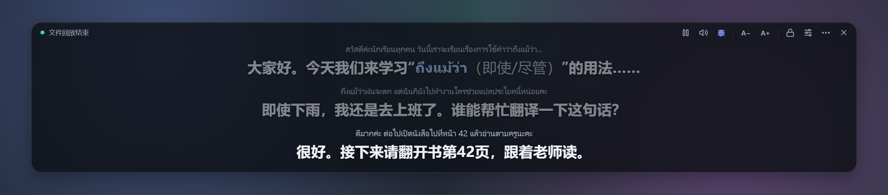
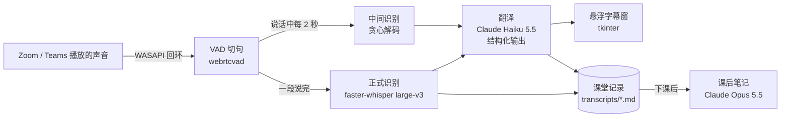
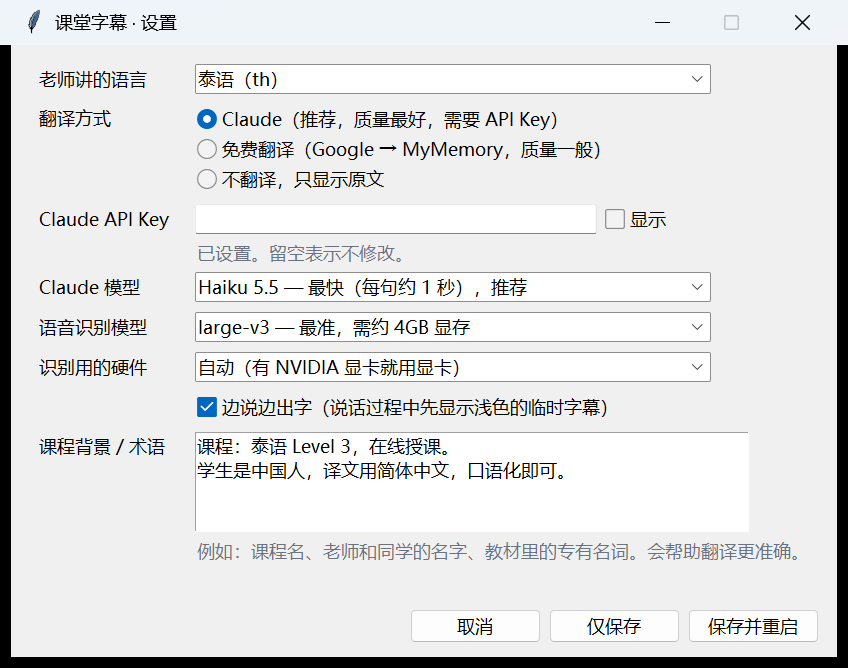

# 课堂实时字幕 · Live Class Subtitles

> 在 Zoom / Teams 上外语课听不懂？这个小工具监听电脑正在播放的声音，把老师说的话实时识别、翻译成中文，以悬浮字幕显示在屏幕上，下课后还能一键整理成复习笔记。



我在学泰语，到 Level 3 时老师开始全程讲泰语、语速很快，上课经常跟不上。于是做了这个工具，边上课边调了好几节课，现在每节课 1000 多句都能稳定跟上。开发过程中踩过的坑和数据记录在 [docs/lessons-learned.md](docs/lessons-learned.md)。

## 功能

- **实时字幕**：直接抓取系统播放的声音（WASAPI 回环），不需要麦克风，用耳机也可以。
- **本地语音识别**：faster-whisper `large-v3` 跑在本机显卡上，音频不出电脑。
- **边说边出字**：老师说话过程中每 2 秒先出浅色的临时字幕，说完再替换成正式字幕。
- **课堂专用翻译**：Claude 按“字幕机”规则翻译，老师讲解的单词保留原文并加中文释义，例如 `ไวยากรณ์（语法）`、`grammar（语法）`。
- **多语言**：泰语、英语、日语、韩语、越南语，或自动识别。
- **悬浮字幕窗**：半透明置顶、可拖动、可调宽高和字号，位置会记住；支持高 DPI 屏幕。
- **锁定模式**：锁定后鼠标点击穿透字幕，不挡住会议软件的按钮。
- **全局快捷键**：在会议窗口里也能隐藏字幕、暂停、锁定。
- **监听设备切换**：一键选择监听哪个耳机/音箱；跟随系统默认设备时会自动跟着切换；长时间没声音会提醒。
- **课堂记录**：每节课的原文和译文自动保存成 Markdown。
- **课后笔记**：一键把整节课整理成概要、重点词汇表、句型、作业通知。
- **设置窗口**：常用选项不用改配置文件；第一次运行会引导填写。

## 工作原理



- 识别 2 个线程并行、翻译 5 路并发，正式字幕优先于临时字幕。
- 识别跟不上时自动合并积压的片段，积压过多就跳过旧内容，保证字幕永远追得上当前进度。
- 翻译使用 JSON 结构化输出，模型的思考过程不会混进字幕。

## 实测表现

在 RTX 2070 SUPER（8GB）+ `large-v3` + Claude Haiku 5.5 下，三节真实泰语课的数据：

| 课次 | 时长 | 识别段数 | 识别耗时（平均） | 翻译耗时（平均） | 积压丢弃 |
|---|---|---|---|---|---|
| 第 1 节 | 61 分钟 | 746 | 0.72 秒 | 1.26 秒 | 0 |
| 第 2 节 | 59 分钟 | 741 | 0.80 秒 | 1.65 秒 | 0 |
| 第 3 节 | 92 分钟 | 1213 | 0.91 秒 | 1.51 秒 | 1 |

一段话说完到正式中文字幕出现约 2～3 秒，临时字幕更早。

## 环境要求

- Windows 10 / 11（音频回环、快捷键、鼠标穿透用到了 Windows 接口）
- Python 3.10～3.12
- 推荐 NVIDIA 显卡，显存 4GB 以上；没有独显可以用 CPU + `small` 模型，但会慢很多
- Claude API Key（[console.anthropic.com](https://console.anthropic.com/)）；没有也能用免费翻译或只看原文

## 安装

```bash
git clone https://github.com/KanbaraKenji/live-class-subtitles.git
cd live-class-subtitles
```

然后双击 `install.bat`：它会创建虚拟环境并安装依赖（含 CUDA 运行库，约 1GB）。第一次启动时会自动下载识别模型（`large-v3` 约 3GB）。

也可以手动安装：

```bash
python -m venv .venv
.venv\Scripts\activate
pip install -r requirements.txt
```

## 使用

1. 先打开 Zoom / Teams 进入课堂，确认能听到老师声音。
2. 双击 `run.bat`。第一次运行会弹出设置窗口，选好老师讲的语言、翻译方式，填入 API Key。
3. 字幕窗出现在屏幕底部，状态栏显示“模型就绪 … 监听中”后即可。老师说话时状态栏右侧会亮 ●。
4. 下课后右键字幕窗选「生成本节课笔记」，或双击 `notes.bat`。



### 字幕窗操作

| 操作 | 方式 |
|---|---|
| 移动 | 左键按住任意位置拖动 |
| 调宽度 / 高度 | 拖右下角 `◢`；双击 `◢` 恢复高度随内容自动 |
| 调字号 | 鼠标滚轮，或顶栏 `A−` / `A+` |
| 暂停 / 继续 | 顶栏 `‖` |
| 选择监听设备 | 顶栏 `🔊` |
| 显示 / 隐藏原文 | 顶栏 `泰`（随课堂语言变化） |
| 锁定（鼠标穿透） | 顶栏 `🔒` |
| 设置 | 顶栏 `⚙` |
| 更多 | 右键菜单：透明度、清屏、打开记录、生成笔记、重置位置 |

### 全局快捷键

| 快捷键 | 作用 |
|---|---|
| `Ctrl+Alt+H` | 显示 / 隐藏字幕 |
| `Ctrl+Alt+P` | 暂停 / 继续 |
| `Ctrl+Alt+L` | 锁定 / 解锁（锁定后只能用快捷键解锁） |

可以在 `config.yaml` 的 `hotkeys` 里改。

### 命令行

```bash
python main.py                         # 正常使用
python main.py --settings              # 打开设置窗口
python main.py --list-devices          # 列出可监听的输出设备
python main.py --review                # 给最新一节课生成笔记
python main.py --review transcripts/2026-11-04_2103.md
python main.py --wav tests/thai_sample.wav   # 用录音文件模拟上课
```

## 配置

| 文件 | 作用 | 是否进 git |
|---|---|---|
| `config.yaml` | 通用配置，带注释，大多数人不需要改 | 是 |
| `user_settings.json` | 设置窗口保存的个人设置，优先于 `config.yaml` | 否 |
| `.env` | Claude API Key | 否 |
| `ui_state.json` | 字幕窗位置、大小、字号 | 否 |

常见调整：

| 想要 | 改什么 |
|---|---|
| 字幕出得更快 | `vad.silence_ms` 调小，`vad.max_segment_s` 调小；代价是句子更碎 |
| 不要临时字幕 | 设置窗口里取消“边说边出字” |
| 翻译更准 | 设置窗口里把 Claude 模型换成 Sonnet 或 Opus；每句会慢 1～2 秒 |
| 显存不够 | 识别模型换 `medium` 或 `small` |
| 专有名词翻错 | 把课程名、人名、教材术语写进“课程背景 / 术语” |

## 测试

```bash
python tests/test_modules.py                       # 单元测试，不需要显卡和网络
python tools/make_test_audio.py                    # 生成泰语测试音频（需要 pip install edge-tts）
python tests/run_headless.py tests/thai_sample.wav # 无界面跑完整流程
python tests/ui_smoke.py --realtime --min-lines 3  # 界面冒烟测试
```

## 常见问题

**状态栏一直没有 ●，也不出字幕。** 监听的设备不对。点顶栏 `🔊` 选会议声音实际播放的设备，或选“跟随系统默认输出”。

**识别很慢，状态栏提示“跳过 N 段”。** 显卡被别的程序占用了，比如游戏、本地大模型、视频剪辑。上课时关掉它们，或者换小一点的识别模型。

**有些句子显示“…”。** 那一段是语气词、噪音或识别不出的内容，程序故意不显示。

**会把我的声音也录进去吗？** 不会。程序只抓扬声器/耳机里播放的声音，不碰麦克风。

## 隐私

- 音频只在本机处理，不保存录音、不上传音频。
- 识别出的文字会发给翻译服务（Claude 或 Google/MyMemory），课后笔记会把文字记录发给 Claude。
- 课堂记录只保存在本机 `transcripts/`，默认不会进 git。
- 请遵守你所在课程和会议平台关于记录课堂内容的规定。

## 项目结构

```
main.py                   入口与命令行
config.yaml               通用配置
app/audio_capture.py      WASAPI 回环捕获
app/segmenter.py          VAD 切句、中间识别触发
app/asr.py                faster-whisper 识别、防复读
app/translator.py         Claude / 免费翻译、提示词、译文清理
app/pipeline.py           线程调度、积压处理、设备切换
app/overlay.py            悬浮字幕窗
app/settings_dialog.py    设置窗口
app/hotkeys.py            全局快捷键、鼠标穿透
app/review.py             课后笔记
app/languages.py          支持的课堂语言
app/transcript_log.py     课堂记录
tests/                    单元测试、无界面测试、界面冒烟测试
tools/make_test_audio.py  生成测试音频
docs/                     截图、经验总结
```

## English summary

A Windows desktop overlay that captures what your PC is playing (e.g. a Zoom/Teams class), transcribes it locally with faster-whisper on your GPU, translates it into Simplified Chinese with Claude, and shows live subtitles in an always-on-top window. It supports Thai, English, Japanese, Korean and Vietnamese, provisional subtitles while the teacher is still speaking, click-through lock, global hotkeys, per-class transcripts, and one-click study notes generated after class. Measured on three real one-hour classes: ~0.8 s recognition and ~1.5 s translation per segment on an RTX 2070 SUPER.

## License

[MIT](LICENSE)
